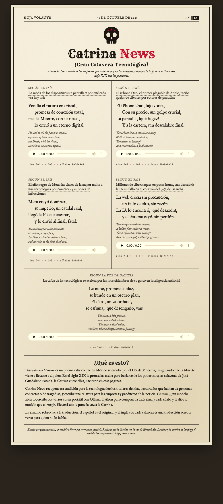

# Catrina News 💀🌼

**Today's tech news, as Día de los Muertos calaveras.** A local open-weight model writes satirical verses about the companies in today's headlines, plain Python checks every rhyme, and the Catrina reads them aloud.

👉 **[catrinanews.tech](https://catrinanews.tech)** · [Leer en español](README.es.md)

Built for the [Hacktoberfest Open-Source AI Challenge, Week 4: Ghost in the Machine](https://dev.to/challenges/hacktoberfest-week4-2026-10-26).



## What's a calavera?

A *calavera literaria* is a short, satirical poem Mexicans write for Día de los Muertos, imagining Death (*la Flaca*, *la Catrina*) coming to take someone away. They began as jokes at the expense of the powerful in 19th-century newspapers, where José Guadalupe Posada's skeletons, the Catrina among them, were born.

Most tools treat calaveras as sweet poems for loved ones. Catrina News goes back to the origin: the satire of the powerful. Today, that's tech companies.

## How it works

```
SerpApi + RSS ──► editor (Gemma) ──► poet (Gemma) ──► rima.py checks ──► gloss (Gemma) ──► ElevenLabs ──► static site
                  picks satirizable    writes the       rhyme + meter,     line-by-line      the Catrina      HTML + MP3
                  headlines, one per   calavera         sends precise      English           reads it         on catrinanews.tech
                  category; code                         feedback, retries
                  drops tragedies
```

1. **Headlines** come from [SerpApi](https://serpapi.com)'s Google News engine (Spain, last 24 hours, with the outlet name and the article's real URL), mixed with El País Tecnología's RSS. Free RSS feeds work too, with no key.
2. **The editor.** Gemma picks the headlines with satirical potential and labels each with a category from a fixed list. Code then keeps one per category, and a regex drops anything about violence, deaths or abuse, even if the model picked it (it once did).
3. **The poet.** Gemma writes a four-line calavera. **Plain Python ([`rima.py`](rima.py)) checks the Spanish rhyme and counts metric syllables** (stress, diphthongs, synalepha), then tells the model exactly what failed: *"line 2 ends in 'director' (sounds '-or'), line 4 in 'mansión' ('-on'); they must rhyme."* Three candidates per headline; code picks the best.
4. **The gloss.** Rhymes don't survive translation, so the Spanish is the original and the English is a line-by-line gloss.
5. **The voice.** ElevenLabs reads each calavera with the Catrina's voice.
6. **The broadside.** [`render.py`](render.py) prints it as a Posada-style *hoja volante*, in English or Spanish.

Everything the reader sees is static: the AI runs once, on a laptop, like a printing press. No server, no API key online.

## What I learned (with numbers)

10 calaveras per run, 5 headlines, up to 3 tries each. Full data from [`prueba.py`](prueba.py) and [`mejorada.py`](mejorada.py).

| | Rhyme 2-4 | Rhyme 1-3 too | Lines of 7-9 syllables | Time per calavera |
|---|---|---|---|---|
| Gemma 3 4B, plain retries | 9/10 | 7/10 | 18/40 | ~9 s |
| Gemma 3 4B + meter feedback + best-of-3 | 10/10 | 8/10 | 30/40 | 29 s |
| **Gemma 3 12B + meter feedback + best-of-3** | **10/10** | **9/10** | **34/40** | 59 s |

- **Feedback works; planning doesn't.** Telling the model *which* sounds failed took the 4B from 4/10 to 9/10 rhymes. Asking it to pick its rhyming pair first made it worse: **2/10**, and it invented words (*"sopio"*, *"lumpo"*) to make them fit.
- **Every rule I added, the model found the loophole.** *Panteón* (graveyard) closed a line in 4 of its first 10 calaveras. Ban it: it switched to *millón*. Ban words used elsewhere in the sheet: it kept the same sound with new words (*razón, decepción, perfección, lección*). The fix was banning rhyme *sounds*, which only code can hear.
- **Guardrails belong in code too.** Given an espionage headline the prompt should have excluded, the model wrote a line mocking "the Chinese man". It never went online; code now drops spy, crime and person-centred headlines, and rejects any stanza that names a nationality or ethnicity.
- **Form is code's job; sense is the model's.** Code can guarantee rhyme and meter. Whether the joke lands depends on model size: the 12B writes *"te vende aire, ¡qué cruel plan!"* where the 4B wrote *"lo envió al millón, ¡qué arroz!"*.
- **The translation exposes nonsense.** *"Lo llevó al reino del brazo"* reads fine in Spanish; in English it's *"took him to the realm of the arm"*.

## Why open models

The satire is written entirely on my laptop by an open-weight model: no API bill per headline, no content policy deciding which companies can be mocked, and nothing that stops working if a service shuts down. The only cloud piece is the voice, used once at "print time". What's published is plain HTML and MP3 files.

## Run it

Requirements: Python 3.15+ (standard library only), [Ollama](https://ollama.com), and optionally [SerpApi](https://serpapi.com) and [ElevenLabs](https://elevenlabs.io) API keys and `ffmpeg`. Keys go in the environment or a `.env` file (`SERPAPI_API_KEY`, `ELEVENLABS_API_KEY`).

```shell
ollama pull gemma3:12b          # ~8 GB; gemma3:4b works too, faster and rougher
python3 hoja.py --fuente serpapi,elpais   # today's headlines → calaveras → hoja_YYYY-MM-DD.json (~10 min on an M1)
python3 hoja.py                 # same, with free RSS only (El País + Google News), no key needed
ELEVENLABS_API_KEY=... python3 voz.py   # optional: the Catrina's voice → site/audio/
python3 render.py               # → site/index.html
python3 -m unittest test_rima   # rhyme and meter checker tests
```

Options: `python3 hoja.py --n 5 --k 3 --fuente ambas`, `HOJA_MODEL=gemma3:4b`, `HOJA_VOICE=<voice id>`.

| File | What it does |
|---|---|
| [`rima.py`](rima.py) | Spanish rhyme (consonant and assonant) and metric syllable counting |
| [`hoja.py`](hoja.py) | The daily pipeline: headlines → editor → calaveras → gloss |
| [`mejorada.py`](mejorada.py) | Generation with feedback, banned rhyme sounds and best-of-k |
| [`fuentes.py`](fuentes.py) | Headline sources: SerpApi Google News and RSS |
| [`traduccion.py`](traduccion.py) | Line-by-line English gloss and headline translation |
| [`voz.py`](voz.py) | ElevenLabs voice over plain REST |
| [`render.py`](render.py) | The bilingual Posada-style broadside |
| [`prueba.py`](prueba.py) | The original feasibility experiment |

## License

MIT
