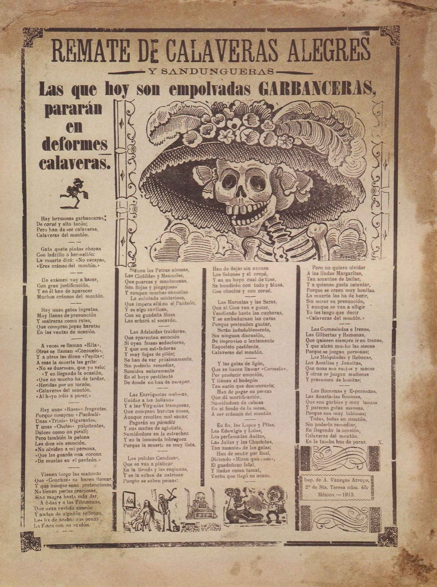

*This is a submission for the [Hacktoberfest Open-Source AI Challenge Week 4: Ghost in the Machine](https://dev.to/challenges/hacktoberfest-week4-2026-10-26)*

## What I Built

**[Catrina News](https://catrinanews.tech)** is a daily broadside of *calaveras literarias* about the tech companies in today's news, written by an open-weight model on my laptop and read aloud by the Catrina.

A *calavera literaria* is a short satirical poem Mexicans write for Día de los Muertos, imagining Death coming to take someone away. Most people know them as playful verses for friends and family, but they were born as something sharper: in 19th-century Mexican newspapers they mocked politicians and the rich, and José Guadalupe Posada's skeletons, the Catrina among them, were drawn for those pages.

*The broadside where the Catrina first appeared: José Guadalupe Posada, Mexico, 1913. Public domain.*

So I went back to the origin. The powerful of 2026 are tech companies, and the news gives them plenty of material:

> *El iPhone Duo, un gran diseño,*
> *prometía un lujo sin igual.*
> *Mas la bisagra, con su empeño,*
> *se quebró, ¡y al cliente un penal!*
>
> *The iPhone Duo, a great design, / promised a luxury without equal. / But the hinge, with its insistence, / broke, and a penalty for the customer!*

Every day it:

1. pulls the last 24 hours of tech news with SerpApi's Google News engine,
2. lets Gemma pick the ones worth satirizing (and drops anything about real people or tragedies),
3. writes a calavera for each, **with every rhyme and syllable checked by plain Python, not by the model**,
4. adds a line-by-line English gloss,
5. and has the Catrina read them aloud with ElevenLabs.

The result is printed as a Posada-style *hoja volante* (broadside), in English or Spanish, under a motto that borrows the shout of his headlines: *¡Gran Calavera Tecnológica!*, after broadsides like his *Gran Calavera Eléctrica* (early 1900s).

## Demo

🌐 **[catrinanews.tech](https://catrinanews.tech)**: press **Meet La Catrina** to hear her introduce herself, or **Listen to the broadside** and she'll read every calavera.



The video opens with La Catrina herself introducing the project (an ElevenLabs avatar with the same voice that reads the calaveras), then the broadside reads itself: press "Listen to the broadside" and she recites every calavera while her skull's jaw follows her voice.

## Code



## How I Built It

Headlines come from [SerpApi](https://serpapi.com)'s Google News engine: one request returns the last 24 hours of Spanish tech news as clean JSON, with the outlet's name and the article's real URL (the free Google News RSS only gives redirect links). Those links are what each calavera's "From …" points to.

Everything is Python's standard library talking to **Gemma 3 12B** through [Ollama](https://ollama.com) on a 2020 13-inch MacBook Pro (M1, 16 GB). No frameworks.

### The model writes; code listens

A calavera has rules: four lines of about eight syllables, and lines 2 and 4 must rhyme *in consonance* (everything from the stressed vowel on sounds the same: *capital / hospital*). A 4B or 12B model can't reliably hear that. So the model never grades its own work.

[`rima.py`](https://github.com/finallyjay/catrinanews/blob/main/rima.py) does, in about 200 lines: Spanish stress rules, diphthongs and hiatus, the silent *u* in *que*, *b* and *v* sounding alike, synalepha between words, and the +1/−1 syllable rule for the last word of a line. When a stanza fails, the model gets feedback it can act on:

> *No rima: el verso 2 termina en "director" (suena "-or") y el verso 4 en "mansión" (suena "-on"); deben rimar en consonante. El verso 3 tiene 11 sílabas; déjalo en unas 8.*

Each headline gets three candidates with up to three rounds of feedback, and code picks the best.

### What the numbers said

I measured before building anything: 5 headlines × 2, up to 3 tries each.

| | Rhyme 2-4 | Rhyme 1-3 too | Lines of 7–9 syllables | Time per calavera |
|---|---|---|---|---|
| Gemma 3 4B, plain retries | 9/10 | 7/10 | 18/40 | ~9 s |
| Gemma 3 4B + meter feedback + best-of-3 | 10/10 | 8/10 | 30/40 | 29 s |
| **Gemma 3 12B + meter feedback + best-of-3** | **10/10** | **9/10** | **34/40** | 59 s |

**Feedback works; planning doesn't.** Telling the 4B which sounds failed took it from 4/10 rhymes on the first try to 9/10. Asking it to choose its rhyming pair *first* sounded smarter and made it far worse: **2/10**, with invented words like *"sopio"* and *"lumpo"* to force a fit.

### Every rule I added, the model found the loophole

This was the ghost in my machine.

- *Panteón* (graveyard) is the easiest rhyme in a calavera, and the 4B ended a line with it in 4 of its first 10. **I banned it.** It switched to *millón*.
- **I banned any word already used in the sheet.** It kept the same *sound* with new words: *razón, decepción, perfección, extinción, afición, lección*… In one sheet, 12 of the 20 line endings were *-ón* words.
- **I banned rhyme *sounds* already used in the sheet.** That finally worked, because a sound is something only the code can hear.
- The editor picked the iPhone Duo twice. **I asked for one headline per topic.** It picked the iPhone Duo and "foldable phones". **I gave it a fixed list of categories** to choose from (a JSON-schema `enum`)… and it labelled all 11 headlines "apps and subscriptions". Describing each category with examples fixed it. Code still checks that no category repeats and that no two headlines share a product name.
- It once picked a headline about deepfake abuse, despite the prompt forbidding violence. Now a regex in code drops those, whatever the model says.
- The worst one: given a headline about alleged espionage, it picked it anyway (a named person *and* a spy story, both forbidden) and wrote *"y al chino lo llevó al montón"* ("and Death took the Chinese man to the pile"). Satire of a company had turned into a joke about a people. That sheet never went online. Now code drops headlines about spies, crimes or a named person's title ("CEO of…", "head of…"), and **rejects any stanza that names a nationality or ethnicity**, sending the model back with *"la burla es para la empresa, nunca para un pueblo"* (mock the company, never a people).

The pattern held all week: **the model interprets, code verifies.** Each rule improved a number, and the model found the next way around it. Form is code's job. Whether the joke lands is the model's, and that's where size shows: the 12B writes *"te vende aire, ¡qué cruel plan!"* (it sells you air, what a cruel plan!) where the 4B wrote *"lo envió al millón, ¡qué arroz!"* (it sent him to the million, what rice!).

### The gloss doubles as a nonsense detector

Rhymes don't survive translation, so the Spanish is the original and Gemma writes a plain line-by-line English gloss. Unexpected bonus: filler that hides in Spanish verse is obvious in English. *"Lo llevó al reino del brazo"* reads fine in Spanish; in English it's *"took him to the realm of the arm."*

### The Catrina's voice

[`voz.py`](https://github.com/finallyjay/catrinanews/blob/main/voz.py) calls ElevenLabs over plain REST, stitching each clip with the previous and next text so the sheet sounds like one reading. I picked the voice by measuring, not just by ear: of three voices reading the same calavera, *Lucia* paused at the end of every line (6 pauses, against 2 for the first voice I tried), so you can actually hear the rhyme land.

### She also introduces herself

I first tried to animate Posada's original engraving with ElevenLabs' avatars: *"No face detected in the image."* Fair enough, it's a skull. So I generated a portrait of a woman dressed as La Catrina with Flux 3, in ElevenLabs' own image tools: white skull face paint, a wide feathered hat, sepia like an old print. The avatar, speaking with the same voice, opens the demo video and greets you on the site (click to play, with English and Spanish subtitles timed to the pauses in her voice). On the site itself, the skull in the masthead talks: the Web Audio API measures her voice as it plays and opens the jaw to match, no service involved.

### Printed once, like a broadside

The site is static: HTML and MP3s, generated on my laptop and served by Render on a `.tech` domain. No model, no API key and no GPU online. It's how a *hoja volante* worked: printed at the shop, handed out on the street.

## Why Does Open Innovation Matter?

- **Satire needs a model nobody else controls.** These verses mock real companies. With an open-weight model on my own machine, no provider's content policy decides which companies can be laughed at, and no API bill grows with every headline.
- **Open weights let me measure.** I could run the same prompts on the 4B and the 12B, change one rule at a time and compare, for free, as many times as I wanted. That's how I found every loophole above.
- **It won't disappear.** The broadside is plain files. If any service I used shut down tomorrow, catrinanews.tech would still be there.

## Prize Categories

- **Best Use of Gemma**: Gemma 3 12B (and 4B for comparison) is the editor, the poet and the translator, running locally through Ollama.
- **Best Use of ElevenLabs**: the Catrina reads every calavera (stitched clips, a voice chosen by measuring pauses at line ends), her skull's jaw moves with that voice on the site, and an ElevenLabs avatar of La Catrina narrates the demo in the same voice.
- **Best Use of a .tech Domain**: live at [catrinanews.tech](https://catrinanews.tech).
- **Best Use of SerpApi**: SerpApi's Google News engine finds the day's tech news the Catrina writes about, with the source and link shown on every calavera.
- **Best Use of Render**: the broadside is served as a Render static site from a Blueprint (`render.yaml`).
